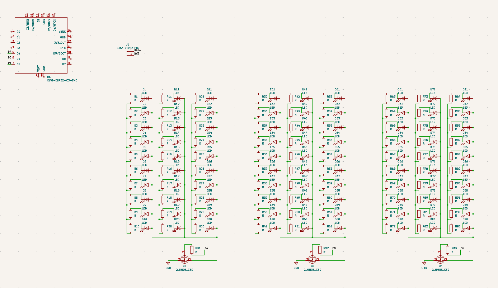
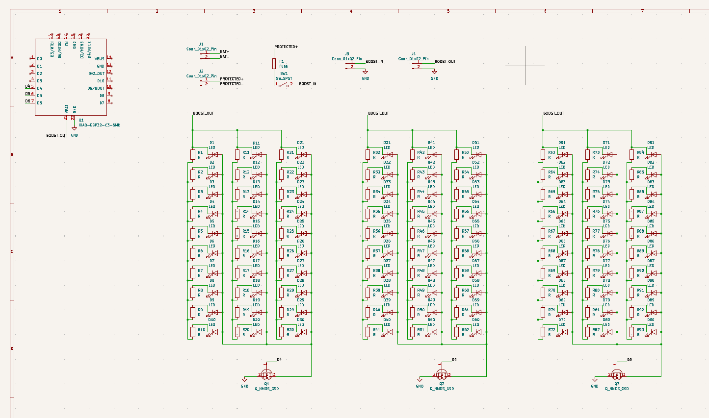
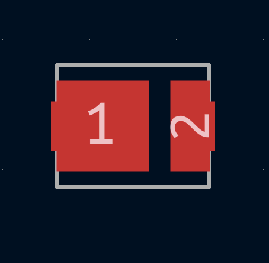
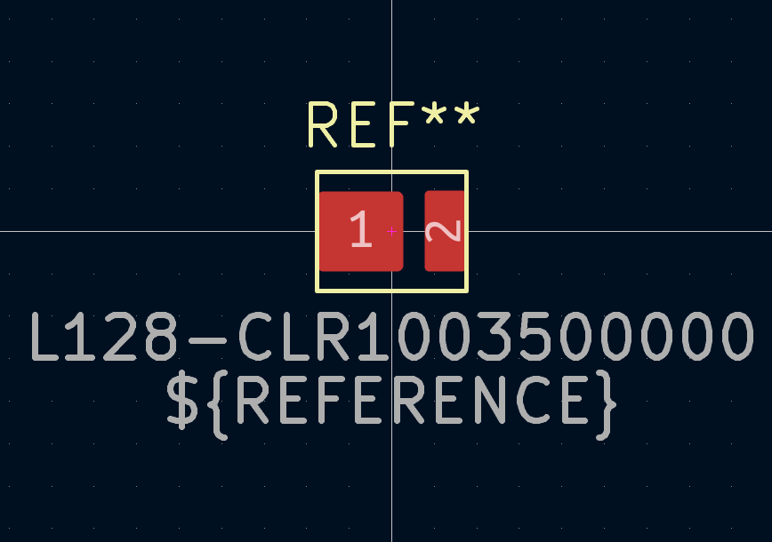
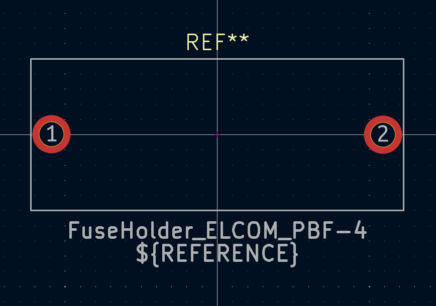
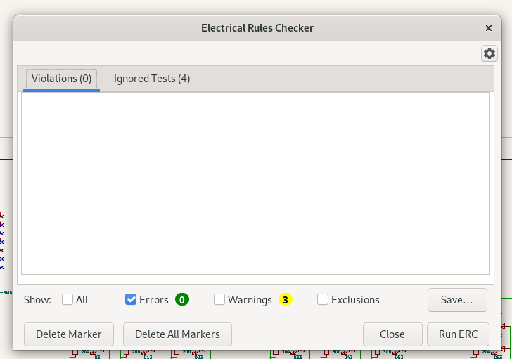
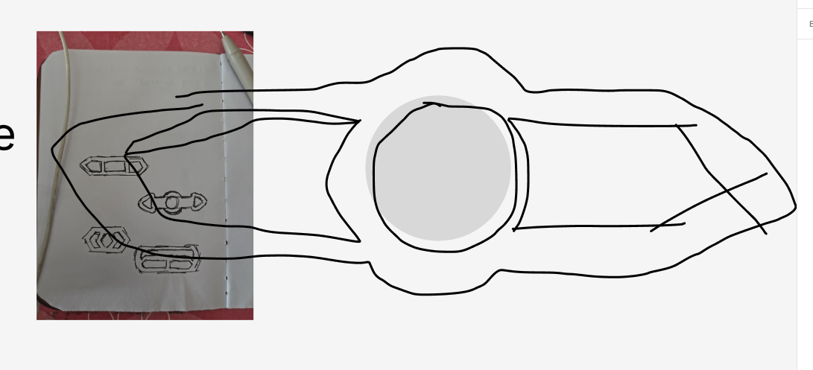

# Oct 12th: NINETY LEDs

a major issue with indikator v1 was that it like 24 LEDs which is too little for it to be properly visible to the road. that paired with the fact that i didn't keep the size in mind while making it and so it became quite large and not very suitable for a bike, hence this rebuild.

there's 90 LEDs now, divided in groups of 3, all connected in parallel. each group is controlled by a MOSFET. this allows me to save A LOT of space compared to the last time where i used that driver thing that only controlled 8 LEDs at once. will work on the battery stuff now which is gonna be slighly more complex than the last time.

**Total time spent: 2h 15m**

# Oct 12th: Power Circuit

yipeee battery stuff, that is, battery, protection board, fuse, switch and the boost thing are all connected now. will work on footprints now.

**Total time spent: 53m**

# Oct 12th: THIS TOOK ME 3 HOURS OH MY GOD BRUH

i wanted to use this red led and found one on digikey but then realised there wasn't a footprint for it so i thought "sure i'll make one" and like it SHOULD be really simple but for some reason my dumass couldn't understand how to get started in the first place. like i couldn't figure out what layers to use and was using rule area to draw the pad ???? anyway yeah i *think* i finished the footprint idk.

**Total time spent: 3h 16m**

# Oct 12th: wait im lowk a genius now

as the title says, im lowk a genius now. i made two more footprints. replaced that bumass led footprint with a MUCH better one that would allow me to use it for any color. created a footprint for the fuse asw. assigned the rest of the footprints and passed erc too. pcb'ing time!

**Total time spent: ~2h?**

# Oct 12th: bruh

i was trying to use this plugin called place footprints which would've allowed me to place stuff in a circle but for some reason it didn't work so i was trying to just get it working. which i finally did in the end. i just had to switch to rpm instead of using the appimage. anyway i attached a image of a design i thought for the layout.

**Total time spent: ~1h 30m**
